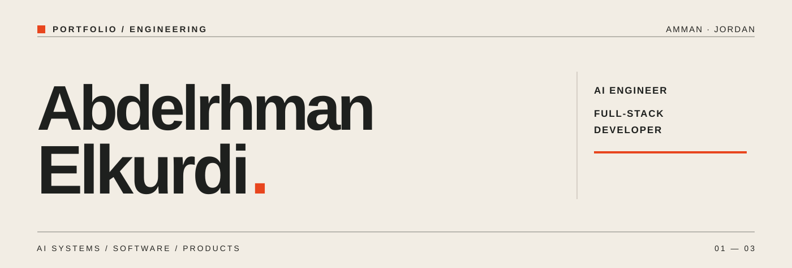

<!--
  Editorial GitHub profile.
  Section 01: shipped client-facing work. Client names and private repositories are not disclosed.
  Section 02: competition recognition. Wording preserved from user-supplied draft.
  Assets live in ./assets; all image paths are repository-relative.
-->

  

  <a href="https://abdelrhman-elkurdi.com"><strong>WEBSITE</strong></a> &nbsp; / &nbsp;
  <a href="https://www.linkedin.com/in/abdelrhman-elkurdi-4a000a219"><strong>LINKEDIN</strong></a> &nbsp; / &nbsp;
  <a href="mailto:abdalrhmankurdi12@gmail.com"><strong>EMAIL</strong></a>

AI engineer and full-stack developer in Amman, studying Data Science & AI at the University of Petra. I chair the IEEE University of Petra Student Branch and build AI systems and products for clients in the region.

01 / SHIPPED
Raw Smith Circle — Live loyalty platform for a specialty coffee café and roastery in Amman. 139+ members and 1,366+ transactions to date.

LAQTA (لقطة) — AI photo activation platform for brand events. Guests are photographed, restyled with AI, and appear live on a public wall. Ran live at an automotive brand launch in Amman.

Operations System (نظام الآليات والمستودعات) — Arabic-first, role-based operations system for a civil contracting company: warehouse stock, requests and approvals, gate log, and reports. Phase 1 built on Cloudflare Workers and D1, now in staff review.

02 / RECOGNITION
DARA' (درع) — AI-powered citizen cybersecurity app for Jordan. Crown Prince Award finalist. I led the team and built the system architecture and fraud-detection engine.

Palm Guard — ESP32-S3 acoustic detection of the Red Palm Weevil. JODA Best Innovation winner and IEEE R8 HTAC finalist. Team project.

03 / TECHNICAL STACK
AREA	TOOLS
Web & APIs	TypeScript · Hono · Next.js
Python & AI	Python · FastAPI · Arabic NLP
Infrastructure	Cloudflare Workers · D1 · R2 · Supabase

<strong>A NOTE ON THE WORK</strong> — Client and internal work lives in private repositories. Demos on request.
